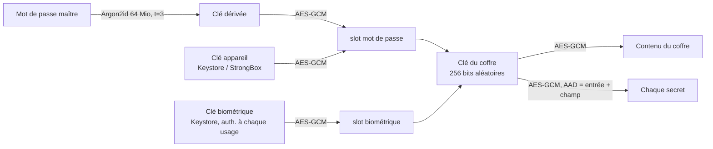

# Secure Vault

[](https://github.com/acapitow/secure-vault/actions/workflows/build.yml)

Gestionnaire de mots de passe chiffré avec authentificateur TOTP intégré, en Kotlin natif.
Projet portfolio en sécurité mobile, aligné sur l'[OWASP MASVS v2](https://mas.owasp.org/MASVS/) (profil L2 + résilience).

- **100 % hors ligne** : aucune permission réseau, aucune télémétrie
- **Chiffrement** : AES-256-GCM, dérivation Argon2id, clé matérielle Android Keystore (StrongBox si disponible)
- **Biométrie liée à la cryptographie** : BiometricPrompt + CryptoObject, pas un simple booléen
- **Double authentification** : codes TOTP (RFC 6238), import par QR code analysé localement
- **Construit uniquement par GitHub Actions** : tests, build signé, contrôle de l'empreinte de signature

## Fonctionnalités

| | |
|---|---|
| Coffre | Entrées titre / identifiant / site / mot de passe / notes, recherche |
| Mots de passe | Générateur CSPRNG (20 caractères, ≈ 125 bits par défaut) |
| TOTP | SHA-1/256/512, 6 à 8 chiffres ; ajout par QR code, lien `otpauth://` ou clé Base32 |
| Déverrouillage | Mot de passe maître ou biométrie forte (classe 3) |
| Verrouillage | Après 5 min d'inactivité, 15 s en arrière-plan, ou à l'extinction de l'écran |
| Presse-papiers | Secrets marqués sensibles, effacés après 30 s |

## Sécurité en bref



- **Pas d'attaque hors ligne** : le slot du mot de passe est aussi chiffré par une clé matérielle non extractible.
  Un fichier copié hors du téléphone ne permet pas de tester un seul mot de passe.
- **Intégrité** : l'en-tête (version, paramètres Argon2id, sel) est authentifié ; une tentative d'affaiblir
  les paramètres est détectée avant toute dérivation.
- **Secrets chiffrés même coffre ouvert** : chaque mot de passe, note et secret TOTP reste chiffré en mémoire
  et n'est déchiffré qu'à l'affichage ou à la copie, dans un tableau effacé ensuite.
- **Environnement** : débogueur, Frida/Xposed ou APK re-signé bloquent l'ouverture en release ;
  le root ne fait qu'avertir (voir [modèle de menace](docs/threat-model.md)).

Documentation détaillée :

- [Architecture et format du coffre](docs/architecture.md)
- [Modèle de menace et limites assumées](docs/threat-model.md)
- [Correspondance OWASP MASVS v2](docs/masvs.md)
- [Signaler une vulnérabilité](SECURITY.md)

## Installation

L'APK est produit par la CI à chaque commit (onglet **Actions** → dernier build → artefact `secure-vault-release`).

Vérifier qu'il vient bien de ce dépôt, avant installation :

```sh
apksigner verify --print-certs secure-vault-release.apk | grep SHA-256
# Signer #1 certificate SHA-256 digest: da5d286cf5cd88c09537fc61812aa55dfc253e972c3fe915255e5daea5a1aa5c
```

Android 9 (API 28) minimum. La caméra n'est demandée qu'au premier scan de QR code.

> ⚠️ **Le coffre est lié à l'appareil et n'est sauvegardé nulle part** (ni cloud, ni transfert d'appareil,
> par conception). Perte du téléphone, réinitialisation ou désinstallation = perte du coffre.
> Il n'existe pas encore d'export : garde une autre copie de tes accès critiques et de tes codes de secours 2FA.

## Développement

| Outil | Version |
|---|---|
| Gradle (wrapper vérifié par SHA-256) | 9.8.2 |
| Android Gradle Plugin | 9.4.1 |
| Kotlin | 2.4.21 |
| compileSdk / targetSdk / minSdk | 37 / 37 / 28 |
| JDK (CI) | 21 |

```sh
./gradlew testDebugUnitTest      # 101 tests JVM (vecteurs RFC/NIST, altérations, sessions…)
./gradlew assembleRelease        # APK minifié par R8
```

Les tests tournent sur JVM : le Keystore et BiometricPrompt y sont remplacés par des clés logicielles,
ce qui couvre toute la logique (slots, invalidation, minuteurs) mais pas le matériel lui-même.

### Organisation

```
app/src/main/java/io/github/acapitow/vault/
├── crypto/     AES-GCM, Argon2id, effacement mémoire, générateur de mots de passe
├── totp/       HOTP/TOTP, Base32, analyse des URI otpauth://
├── vault/      format du fichier, coffre en mémoire, clés Keystore (appareil, biométrie)
├── session/    verrouillage automatique, limitation des tentatives
├── security/   détection root / débogueur / instrumentation / re-signature
└── ui/         Compose : écrans, BiometricPrompt, scanner QR, presse-papiers
```

### CI (`.github/workflows/build.yml`)

1. Tests unitaires (avant tout accès aux secrets de signature)
2. Build debug + release signés avec la clé stable (secrets GitHub, fichier supprimé en fin de job)
3. Contrôle : l'empreinte du certificat intégrée à l'APK (`BuildConfig.EXPECTED_SIGNER`)
   doit être celle de son certificat réel, sinon le build échoue
4. Publication des APK, du `mapping.txt` R8 et des rapports de tests

Actions épinglées par SHA de commit, `GITHUB_TOKEN` en lecture seule, wrapper Gradle validé.

## Licence

© 2026 acapitow — **tous droits réservés**. Code publié pour consultation uniquement :
aucune réutilisation, copie ou redistribution sans autorisation écrite. Voir [LICENSE](LICENSE).
