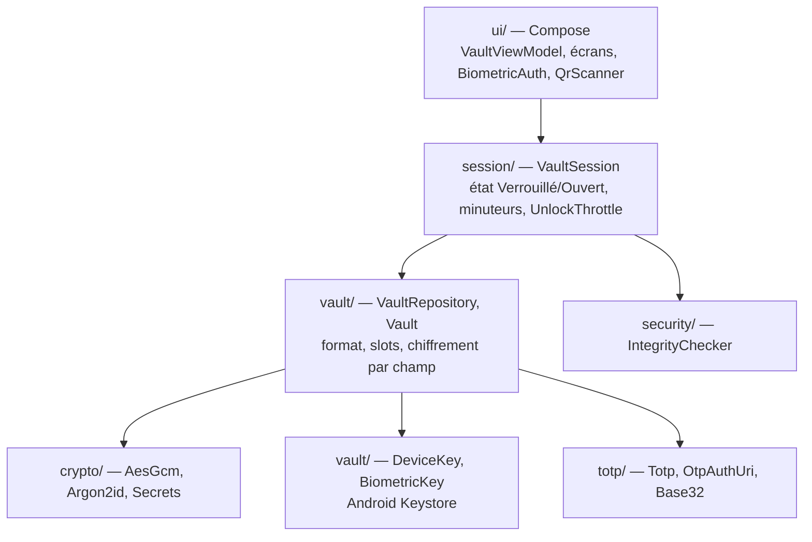
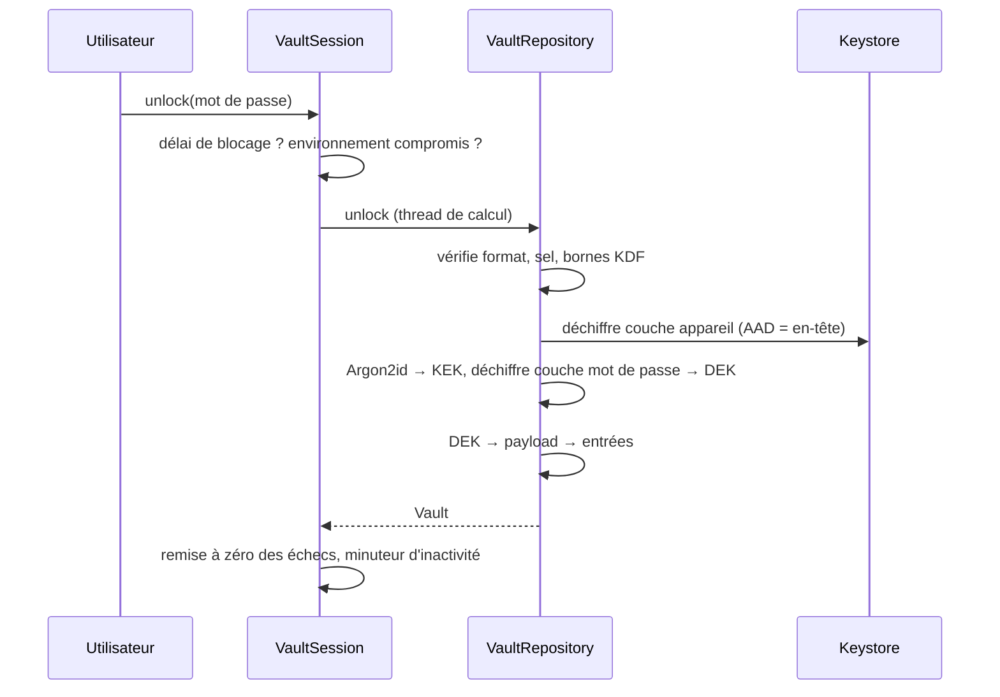

# Architecture

## Couches



Les couches `crypto`, `totp`, `vault` (hors `DeviceKey`/`BiometricKey`/`AndroidKeys`), `session`
et `security` (hors `AndroidProbe`) n'utilisent aucune API Android : elles sont testées sur JVM.

`VaultSession` est l'unique détentrice du coffre déverrouillé. Le ViewModel n'en garde aucune
référence ; il n'expose que la liste des entrées (métadonnées, sans secret en clair), vidée au verrouillage.

## Hiérarchie de clés

| Clé | Origine | Où | Rôle |
|---|---|---|---|
| **DEK** (clé du coffre) | 256 bits `SecureRandom` | mémoire uniquement, coffre ouvert | chiffre le contenu et chaque secret |
| **KEK** | Argon2id(mot de passe, sel) | mémoire, effacée après usage | chiffre la DEK (couche intérieure du slot mot de passe) |
| **Clé appareil** | Keystore, StrongBox sinon TEE | matériel, non extractible | couche extérieure du slot mot de passe |
| **Clé biométrique** | Keystore, auth. biométrique forte à chaque usage, invalidée par un nouvel enrôlement | matériel | chiffre la DEK (slot biométrique) |

Changer le mot de passe ne rechiffre pas les données : seul le slot mot de passe est recalculé
(nouveau sel). La DEK ne change pas.

## Format du fichier

`noBackupFilesDir/vault.json`, exclu de toute sauvegarde :

```json
{
  "header": {
    "format": 1,
    "kdf": { "memoryKiB": 65536, "iterations": 3, "parallelism": 1 },
    "salt": "<16 octets, base64>",
    "passwordSlot": "<base64>",
    "biometricSlot": "<base64> | null"
  },
  "payload": "<base64>"
}
```

Chaque bloc chiffré a la forme `version (1) ‖ nonce (12) ‖ texte chiffré ‖ tag (16)`. L'octet de
version fait partie des données authentifiées. Le nonce est généré par le fournisseur à l'initialisation
du `Cipher` (seul mode accepté par le Keystore).

| Bloc | Clé | AAD |
|---|---|---|
| `passwordSlot` | clé appareil ( KEK ( DEK ) ) | `secure-vault/v1/{device,password}-slot;m=…;t=…;p=…;salt=…` |
| `biometricSlot` | clé biométrique ( DEK ) | `secure-vault/v1/biometric-slot;m=…;t=…;p=…;salt=…` |
| `payload` | DEK | `secure-vault/v1/payload` |
| chaque secret | DEK | `secure-vault/entry/<id>/<PASSWORD\|NOTES\|TOTP>` |

Conséquences :

- toute modification de l'en-tête casse les AAD des slots → coffre refusé (« illisible ») avant même Argon2id ;
- les paramètres Argon2id lus sont en plus bornés (≥ 19 Mio, t ≥ 2, plancher OWASP) contre une dégradation ;
- un secret copié vers une autre entrée ou un autre champ ne se déchiffre pas ;
- l'écriture est atomique (fichier temporaire, `fsync`, `rename`) : un arrêt brutal laisse l'ancien coffre intact.

Le contenu (`payload`) est un JSON `{"entries": [...]}` : métadonnées en clair une fois déchiffré,
secrets toujours sous forme de blocs chiffrés individuels.

## Flux

### Déverrouillage par mot de passe



Mot de passe faux → `WrongPasswordException`, compté par `UnlockThrottle`. En-tête altéré ou clé
appareil différente → `CorruptedVaultException`, non compté.

### Biométrie

1. **Activation** (coffre ouvert) : nouvelle clé biométrique → `Cipher` en chiffrement → BiometricPrompt
   avec `CryptoObject` → le `Cipher` débloqué chiffre la DEK → `biometricSlot`.
2. **Déverrouillage** : `Cipher` en déchiffrement initialisé avec le nonce du slot → BiometricPrompt →
   le `Cipher` débloqué déchiffre la DEK.
3. **Invalidation** (empreinte ajoutée) : l'initialisation du `Cipher` échoue
   (`KeyPermanentlyInvalidatedException`) → slot et clé supprimés, mot de passe requis.

Le succès biométrique n'est jamais un booléen : sans authentification réelle, le Keystore refuse
l'opération, même si le callback `onAuthenticationSucceeded` est forcé par instrumentation.

### Verrouillage automatique

`VaultSession` verrouille (ferme le `Vault`, efface sa référence) :

- après `idleMs` (5 min) sans interaction (`Activity.onUserInteraction`) ;
- après `backgroundMs` (15 s) en arrière-plan (`ProcessLifecycleOwner`) ;
- immédiatement à l'extinction de l'écran (`ACTION_SCREEN_OFF`).

Android peut geler un processus en arrière-plan : un minuteur ne suffit pas. L'instant du passage en
arrière-plan est mémorisé et l'écoulé vérifié au retour, sur `elapsedRealtime` (monotone, non modifiable
par l'utilisateur).
